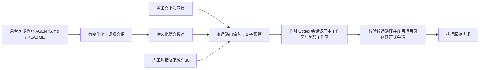

# 工作区自动选择

本文是工作区 Router 的行为与决策记录，供后续开发、评审和排查使用。Router 继续通过临时 Codex 会话做判断；本次先完善输入准备和工作区设置，Jev/Laya 与其他模型接入后置。不要再次将已确定的缓存、纠错和计时口径当作未决问题。

## 目标和调用链

新 Codex 会话未手动指定工作区时，用户发送首条消息后自动选择工作区并开始任务；手动指定目录直接跳过 Router。Claude 沿用自身会话流程。

三步职责分别是：准备输入、调用判断后端、校验并设置工作区。当前第二步保持 Codex；不要为了未来换后端扩展通用 Provider 框架。

## 已确定的决策

以下决策来自 2026-11-06 的功能评审及用户本轮实施要求。

| 决策 | 行为与原因 |
| --- | --- |
| 保留自动选择 | 用户对选择效果整体满意，当前重点是输入维护与纠错闭环 |
| 每24小时检查文档 | 按工作区记录检查时间；比较内容哈希，只有内容变化才调用模型，修改时间变化不触发生成 |
| 后台生成、路由读缓存 | 首次无缓存时后台补建；发送首条消息不等待简介生成，未建好时使用名称、路径和手填说明 |
| 读取有明确范围 | 只读 checkout 根目录的 AGENTS.md 与首个可用 README.md/readme.md/README/README.rst；不递归扫描、不执行文档指令、不跟随文档中的链接 |
| 保留旧简介 | 更新失败保留旧版本；生成期间文档变化则拒绝旧结果，后续检查重做 |
| 复用当前 Router 模型设置 | 简介生成使用当前配置的模型和推理强度，独立只读临时会话，来源标记 workspace-router-summary；本期不增加另一套模型选项 |
| 人工纠错进入后续输入 | 只用明确“不准”且指定了正确工作区的记录；继续聊天产生的 implicit-accurate 不作为人工确认或学习案例 |
| 切换必须由用户点击 | “保存反馈”继续当前任务；“保存并切换工作区”仅在会话空闲时执行，不自动停止、重发、重做或回滚已有操作 |
| 判断后端暂不更换 | Jev/Laya 实验已有速度收益，但样本和图片能力不足以支持替换；其他大模型后端继续后置 |

用户关闭应用或电脑休眠时不检查，恢复后补查到期项目，不启动额外常驻进程。宿主每5分钟唤醒一次检查，原生24小时状态决定是否读取文件；新工作区或 checkout 变化触发首次检查。每次顺序生成一个工作区简介，SQLite 事务与5分钟租约避免稳定版/开发版或多个窗口重复生成；过期任务不能覆盖新任务。失败后下一次24小时检查重试。

文档单文件最多1 MiB，拒绝解析到工作区外的符号链接。内容哈希覆盖完整文件，摘要输入每份文档最多6,000个本地 tokens；仅用于说明职责和项目边界。未找到文档时不调用模型；删除文档后清空过时的自动简介，仍保留手填用途。

## Router 管理页

会话页签栏保留核心「Router」页签与排序，打开后不显示聊天输入区。设置对话框中的 Router 入口继续保留，两个入口使用同一组件与全局持久配置。

2026-11-06 用户要求收紧界面：移除标题、分区及设置中的说明小字；按「工作区 / 最终 Prompt / 反馈 / 设置」四个分区组织。

- **工作区**：状态在标题左侧，以颜色和文字共同表示；路径与标题同行，检查倒计时在「立即更新」左侧。上次检查、生成及下次检查时间合并到倒计时的 tooltip。正文只保留「介绍」、补充说明输入框及详情内部的保存按钮，失败时仍展示旧介绍。
- **最终 Prompt**：纯只读查看页，打开即自动组装，不提供用户输入框、编辑或生成按钮。用户输入位置固定显示 `{{用户输入}}` 占位；按已保存设置读取当前简介、挑选纠错并执行文字预算，复用实际路由的 `routingCandidates` / `prepareRouterPrompt`，展示 `developerInstructions`、`input` 和 `outputSchema`。切入页签、保存设置或介绍缓存变化时自动刷新，不启动模型、不保存查看正文。真实路由会填入首轮需求并重新选择相关案例；本页不声称重放历史发送内容。App Server 自动背景仍按原协议处理，本页展示 Harness 组装提交的字段。
- **设置**：三个后端区域纵向排列。Codex 临时会话区域可设置模型、推理强度；Jev/Laya 与其他模型 API 以各自字段展示并禁用，这是用户本轮明确选择，不接通或切换后端。通用设置包括文字预算、纠错引用上限（0–10）和规则（相关优先/最近优先）。
- **反馈**：按反馈时间分页列出每次路由最新的人工反馈，包括原始需求、原选工作区、人工纠正及时间；不把 implicit-accurate 计为人工反馈。正文按来源标识从 Provider 精确读取，缺失时明确显示，不复制到 SQLite。含附件的消息可展示文字与附件标记，但不作为文本纠错案例。

「立即更新」跳过24小时等待，仍以内容哈希决定是否调用模型；未变化不重生成。手动更新与后台共用串行队列和原生跨实例租约。检查倒计时不承诺模型到点完成；更换模型也不自动使缓存失效。

## 输入预算和案例

默认文字预算为8,192 tokens，可在 Router 设置中调整为2,048–32,768。以本地 o200k_base 计数，包含应用提供的路由指令、输出 schema、工作区目录、案例和原始用户文字，并预留64 tokens 的包装余量；图片及 App Server 自动注入的内容另计。这个数是应用文字预算，不宣称等于模型最终上下文或协议总输入。

每个工作区自动简介保存前最多192 tokens。手填用途优先于自动简介排列，送入模型前一起受到描述长度限制。所有候选工作区的名称和路径保留；预算不足先减少案例，再缩短介绍。原始用户文字不会静默截断；连候选和原始文字都放不下时停止路由，保留草稿，提示提高预算、缩短消息或手动选择工作区。

案例默认最多3条，可配置0–10条，0表示不加入。每条需求最多256 tokens；从最近20条明确纠错记录中读取有效来源，Provider并发最多4。相关优先按英文词与中文双字片段重合度筛选排序；最近优先按人工反馈时间排序，不要求关键词重合。来源不可用、正确或错误工作区已不可见时跳过，不把历史纠正当作覆盖当前需求的永久规则。最终条数还受可用案例和总文字预算限制。两种规则都只向 Prompt 加入明确纠错；准确反馈保留在反馈列表。

案例只保存会话、轮次、消息标识和纠错目标，原文从 Provider 的第一轮历史中精确匹配读取；缺失、读取失败、无法匹配、涉及图片或内容过长时跳过，不用其他消息代替。原文仅有有界内存缓存，不复制进状态库。简介正文保存于独立的 router-summaries 文件目录，SQLite 只保存索引、哈希、时间和租约；版本文件原子写入后才提交索引，失败不覆盖旧索引。既有路由记录继续保存手填用途等元数据，不保存模型生成的简介或用户需求正文。

## 选择与纠正当前工作区

判断输出仍为 `primary` 和 `related`：前者必须是候选 root 或 null，后者必须来自候选集合。主工作区从关联列表移除，重复项去重，通用请求不能同时带关联工作区。正式会话使用主工作区的 checkout；关联工作区只作为说明交给 Agent，不隐式扩大工作区权限。

首次执行保持已有的草稿迁移、项目绑定迁移和原始输入引用处理；生成选择失败时不启动用户任务。反馈中的正确工作区使用 root 标识，执行切换时重新从当前目录解析 checkout，不直接沿用历史路径。

反馈卡片提供两个动作：

- 保存反馈：记录人工纠正，用于后续输入，当前目录和执行不变。
- 保存并切换工作区：保存反馈后复用核心目录设置和权限更新流程。会话执行中、发送中、归档或目标已不可见时拒绝；通用请求使用 Harness 管理的中立目录。切换失败保留反馈并显示错误，用户可以重试。

切换只影响后续消息，原来的历史、已经完成的文件操作与最初 Router 选择保留。切换不会自动发送新消息或重新消费一轮 Codex。用户继续发送消息后，反馈卡片仍按既有约定收起。

## 已有实验与容易重犯的错误

2026-11-06 从本机日志核实的7次 Codex 路由：平均6.862秒、中位6.269秒、nearest-rank p95 10.690秒。计时覆盖路由阶段，不覆盖点击发送到正式回答首字；样本p95是这7次的最大值。不得把这一口径写成端到端首字耗时，也不得把 implicit-accurate 计入人工确认正确率。

同日实际检查测试服务器 `10.251.137.89:5050/laya`：运行的是 Laya/arbiter，CPU FP32，并非云端 Jev 本体。已有 Harness Jev 封装固定连接 Vercel，不能仅替换 URL 就认定兼容。云端权限失效是用户提供的背景，本轮未重新调用验证。

首轮离线实验使用22个当前可见工作区名称加通用选项，7条历史需求、两个模型、每条重复3次，共42次真实HTTP请求，全部成功。5条纯文本有明确人工“准”反馈，其中4条属于 Harness、1条属于 DNS API；另外2条带图且未明确确认，去掉图片后仅作探索。

| 后端 | 5条确认文本 case 正确数 | 平均 / p50 / nearest-rank p95 |
| --- | --- | --- |
| Laya multilingual | 4/5 | 0.963 / 0.928 / 1.243秒 |
| Laya typed-decisions | 5/5 | 2.850 / 2.756 / 4.269秒 |
| 历史 Codex Router | 不作本轮同条件准确率比较 | 6.862 / 6.269 / 10.690秒 |

Laya 耗时统计各21次请求，含去图探索样本；重复调用没有增加独立案例数量。multilingual 将 DNS API/Core API 内存分析选成 dns-agent；typed-decisions 对两条去图界面问题都选成 yf-agent，原 Router 选择为 Harness。不得把5/5写成已证明可替换、把当前候选名称当作历史候选快照，或将缺图实验成绩归因于模型完整多模态能力。

实查两个 Laya 模型 max_len=1024、head_max_len=256，英文版 max_len=512；SDK 存在截断逻辑。不能直接照搬本期 Codex 的文字预算。未来重新评估时需要模型自己的分词、候选预算、图片与 related 策略，以及覆盖通用问题、相邻 DNS 仓库和跨工作区需求的独立测试集。本期暂停这些优化。

## QA 与维护入口

**为什么只按天检查，而不每次发送都读取并生成？** 文档变化频率低，用户明确要求减少额外 Token；每日内容哈希检查只在变化时触发生成，首条消息直接使用持久缓存。

**为什么保存反馈后不立即重跑任务？** 首轮已经可能执行文件或外部操作，自动重跑会重复执行。用户显式切换只更新后续目录，已有结果仍可追溯。

实现入口：[核心路由](../src/core/workspace-router/service.ts)、[简介调度](../src/core/workspace-router/summaries.ts)、[案例选择](../src/core/workspace-router/examples.ts)、[原生缓存](../src-tauri/src/store/router.rs)、[文件读取与预算](../src-tauri/src/workspace_router_context.rs)、[反馈卡片](../src/features/conversation/RouterFeedbackCard.tsx)。

验证入口：同目录 Vitest 覆盖路由、简介生成、案例来源匹配；Rust 临时目录与SQLite测试覆盖24小时去重、跨连接租约、哈希变化、原文不进库、并发修改拒绝和预算；会话 Hook 与卡片测试覆盖保存反馈及显式切换。真实 Codex 摘要生成和原生窗口交互应在安装开发构建后人工验收，自动化测试不读写真实用户数据或调用模型。

初版界面截图（历史，供比较）：[本地组件预览与检查脚本](../tests/visual/README.md#工作区简介与纠正)、[深色宽窗口](../docs/review/workspace-router/dark-wide.png)、[浅色窄窗口](../docs/review/workspace-router/light-narrow.png)、[执行中限制切换](../docs/review/workspace-router/running.png)。截图使用实际组件与隔离示例数据。

早期管理页截图（历史）：[介绍与倒计时](../docs/review/workspace-router/router-tab-dark.png)、[第二步配置](../docs/review/workspace-router/router-options-dark.png)、[浅色窄窗口](../docs/review/workspace-router/router-tab-light-narrow.png)、[保留旧介绍的失败状态](../docs/review/workspace-router/router-failed-light.png)。预览文案是示例数据，自动化检查不会发起真实模型调用。

当前精简版：[工作区](../docs/review/workspace-router/compact-workspaces-dark.png)、[后端与反馈设置](../docs/review/workspace-router/compact-settings-dark.png)、[最终 Prompt](../docs/review/workspace-router/compact-prompt-dark.png)、[逐条反馈](../docs/review/workspace-router/compact-feedback-dark.png)、[浅色窄窗口](../docs/review/workspace-router/compact-workspaces-light-narrow.png)。预览均使用示例数据；原生文字预算由 Rust 执行，浏览器 fixture 只演示短样例的载荷格式。
