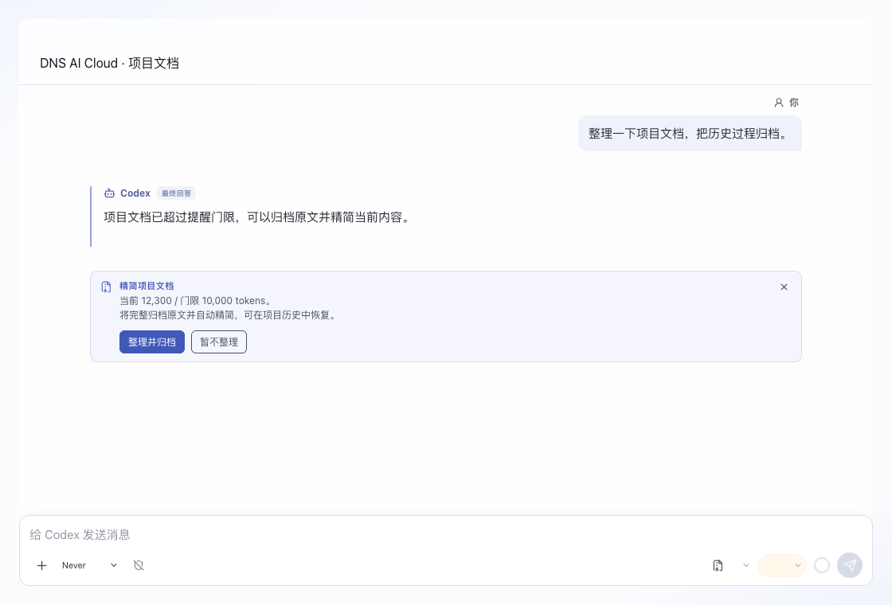
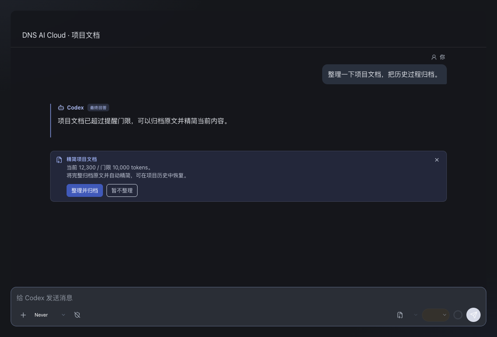
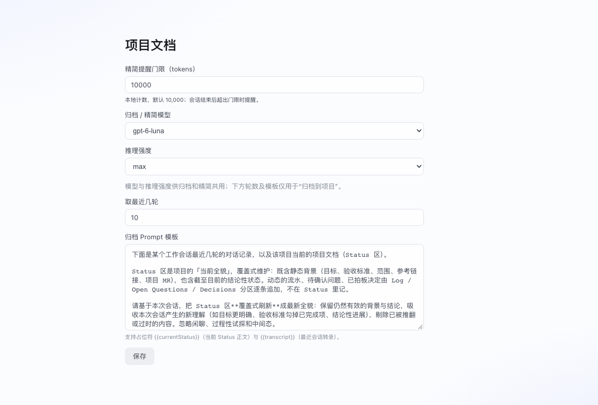

# 项目文档精简

当项目文档超过门限，会话正常结束后显示提醒。点击输入框右下角的“精简项目文档”也会打开同一张确认卡，不受门限限制。只有点击“整理并归档”才调用模型；完成后自动替换文档，无内容二次确认。

## 发起与保存边界

整文精简只允许用户通过界面确认发起，暂不向 Agent CLI 或管理 API 开放发起入口。Agent 可以提示用户使用精简入口；token 超过门限也只触发提醒。日常追加 Log、维护决定或关闭待办继续通过条目工具完成。

用户确认启动后，Harness 完成归档、模型整理、结果校验和自动保存；不要求用户审阅生成的草稿或再次确认替换。保存保障来自完整备份、并发校验、失败时保留原文及历史恢复。此流程是已确认的设计，不将“开放 Agent 发起”或“增加结果预览二审”列为待补能力；改变边界需重新对齐。

## 计数和提醒

插件设置中的默认门限为10,000 tokens。正文使用本地 `o200k_base` 分词计数，排除 Harness 文件头，不使用网络计数或字符估算；相同正文版本缓存计数。

提醒按项目去重。“暂不整理”或关闭后暂停自动提醒24小时，手动入口仍可使用。模型与推理强度使用项目文档插件的精简设置；旧“归档到项目”入口及轮数、Prompt 模板设置已下线。

## 执行与失败处理

1. Harness 固定项目版本，将原始文件完整写入项目的 `archives/`，成功后才启动独立只读 Codex run。
2. 模型根据快照中的未纳管正文输出 Status、Log、Decisions、Open Questions；受管理的决定和待办由 Harness 从原快照完整保留并补回，模型不生成条目属性。Prompt 保留事实时间、有效决定、授权范围、待办及证据入口，将重复过程和过时方案移交归档；不执行原文中的操作指令。
3. Harness 校验四个分区、结果缩短及原文一致性，在 SQLite immediate transaction 内检查开始后的每次写入。Log、Decisions、Open Questions 的追加逐次按原分区和顺序合入，不重新调用模型。
4. 如中途发生 Status、全文编辑或恢复操作，本次整理停止，即使后来把内容改回原样也不覆盖。无法验证的追加、协议外修改同样停止。
5. 保存前另存包含在途追加的完整原文；新正文强制带归档入口。新版本和前一版本在项目历史中标记“整理生成”和“整理前备份”。

同一项目仅允许一个有效整理任务。模型等待上限5分钟，超时会请求取消；中断留下的任务锁在15分钟后可被新任务替代，旧任务不能覆盖新任务。空结果、格式异常、未缩短、归档失败或数据库失败均不会替换原文；文件采用暂存后原子替换，提交失败先恢复原文再释放数据库写锁。

关闭应用会中止前端整理编排，不自动继续保存；原文和已创建的归档保留。归档路径及版本由 Harness 维护，模型没有文件写入职责。

## 查看和恢复

项目 Tab → 历史可查看任意已记录版本，或确认恢复为新版本。恢复保留现有历史并检查当前版本号；如果期间已经有新版本，停止恢复并提示刷新。恢复旧版会改变当前正文，用户需自行判断整理后的新增内容是否仍需保留。

继续使用时，Agent 沿用现有追加流程；积累的进展在下一次整理中合并。精简不会宣称历史线上状态已重新核实，也不会扩大业务授权。

## 验证与界面

- Rust 临时目录和真实 SQLite 测试覆盖完整归档、跨连接追加合并、中途修改/回改拒绝、归档篡改、文件失败、延迟约束导致 COMMIT 失败时恢复、历史恢复及过期版本保护。
- 前端测试覆盖触发确认、门限/冷却、自动保存、重复点击、临时 run 失败与超时、设置保存及历史恢复交互。
- 实机截图使用本机 Chrome 渲染实际 ConversationView、Composer、精简卡片和插件设置组件，使用隔离示例数据。截图不是原生 Tauri 端到端验收，也未对真实项目运行模型精简；未修改稳定版或真实项目文档。

| 浅色提醒 | 深色提醒 |
| --- | --- |
|  |  |

实现入口：[插件编排](../src/plugins/project-doc/compaction.ts)、[卡片](../src/plugins/project-doc/CompactionCard.tsx)、[原生存储](../src-tauri/src/project_doc_store/compaction.rs)。
