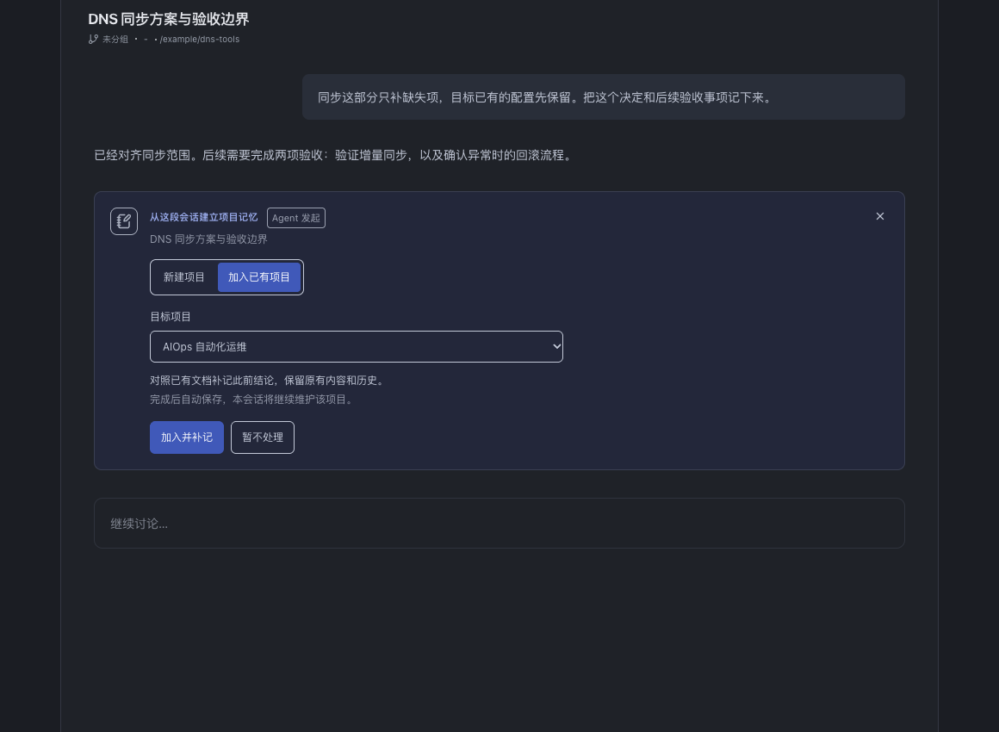
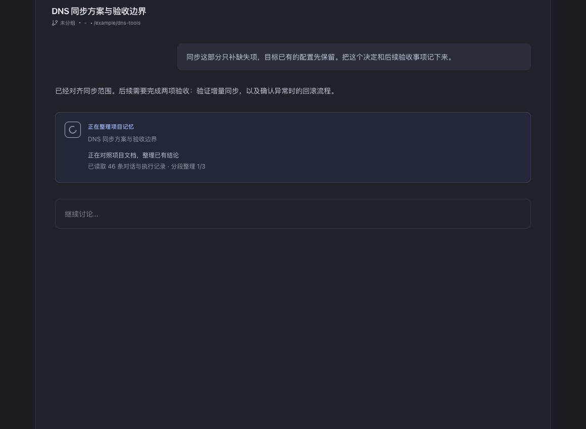

# 从会话建立项目记忆

未绑定项目的会话可以在中途新建项目或加入已有项目，并补记此前结论。人工按钮和 Agent Skill 请求共用确认卡；用户确认后才执行。已绑定会话保持原归属，本功能不迁移项目。

## 入口与执行

输入区“精简项目文档”旁的“新建或加入项目”按钮打开确认卡。新建时填写名称，加入时选择项目。Agent 通过随应用分发的 project-doc Skill 执行 `projects`、`request-create` 或 `request-join`；申请仅显示确认卡，不创建、不绑定、不写文档，也不启动模型任务。

确认后沿用精简功能的模型设置，启动独立、只读的 Codex 临时会话。原会话可以来自 Codex 或 Claude，工作目录保持不变。卡片展示读取、整理、保存、等待绑定、完成和失败状态。临时会话只返回变更计划，由 Harness 原生层校验和保存。启动前确认覆盖本次初始化或补记，完成后无结果二次确认；后续日常 Status 更新仍走原审批规则。整文精简仍仅允许用户从界面发起。

## 会话材料

确认时读取持久化历史，Codex 按正序遍历所有分页，Claude 使用 SDK 历史接口。整理用户和 Agent 正文及命令/MCP 执行结果，不只取界面已加载的最近几轮，不复制推理过程。附件实体不复制；已有对话中记录的结论和证据入口继续保留。

短历史直接整理；长历史按每段约 60,000 个字符分段提炼，再汇总成最终计划。不会静默截取最近 N 轮。分段摘要若仍过长会继续分组压缩；不收敛、无输出、格式错误或任务超时均停止，不写入目标文档。单个临时任务上限 5 分钟。

加入已有项目时另提供完整文档快照、seq 和条目属性，先跳过重复内容，再按原有职责补记。目标正文超过 180,000 字符或存在协议外修改时提示用户先检查或人工精简，不截断目标文档。临时会话不获得目标项目绑定，不直接调用写工具。

## 保存与绑定

新项目在有效计划形成后才创建，初始化四个分区。已有项目可更新 Status、追加 Log/决定/待办，并通过原生条目逻辑修订、替代、撤销、完成或重开；旧段落可精确纳管。模型不能生成系统属性，也不能硬删除条目。

整批补记在 SQLite immediate transaction 内检查目标版本，原子生成一份新快照；任何条目操作失败则整批不保存。生成期间目标文档发生变化时拒绝旧结果，用户可重新整理最新版本。相同请求 ID 使用版本回执去重，防止超时重试重复追加。

保存成功后再关联原工作区和来源会话。原生层复查来源会话空闲；正在执行时等待轮次边界，后续消息加载项目背景和原生 Skill。绑定失败时保留保存回执，重试只完成绑定；应用重启也可从回执恢复，已完成标记与绑定在同一状态事务中保存。会话随后被用户解绑时，不会因历史回执再次自动绑定。

未保存任务的编排在关闭应用后停止，不自动重放写入。临时会话的读取和结果属于 Provider 历史；Harness 状态库只保存任务/绑定元数据，不额外保存来源对话、模型结果或文档正文。

## Skill 与管理接口

未绑定会话也可原生发现 project-doc Skill，维护正文仅在绑定后主动加载。Codex 在原生 Skill 列表发现应用副本；Claude 为会话和 Skill 列表查询提供本地插件。首次准备时附带来源会话标记，命令不能用当前选中会话替代来源。

管理入口仅新增 `projects.list` 和 `projects.requestOnboarding`，后者检查来源会话与插件卡片是否可用。没有远程确认或直接提交接口。保存和绑定通过 Rust IPC、bridge 和核心服务执行。

## 验证与截图

自动检查覆盖历史分页、分段完整性、未确认不执行、并发版本冲突、原子补记、请求去重、绑定失败重试和重启恢复。临时目录/SQLite、假 SDK 与本地假模型服务不修改真实项目文档。

以下是本机 Chrome 渲染生产卡片与应用样式的截图，使用隔离示例数据；不是绘制的效果图，也不代表完成了真实 Tauri 应用和模型的端到端验收。可执行 `pnpm exec vite --host 127.0.0.1 --port 1438`，打开 `/docs/review/project-onboarding/preview.html` 复查。

| 新建项目 · 浅色 | 加入项目 · 深色 |
| --- | --- |
|  |  |

| 整理中 | 完成 |
| --- | --- |
|  |  |

[失败状态](review/project-onboarding/error-light.png) · [窄窗口](review/project-onboarding/narrow-dark.png)
