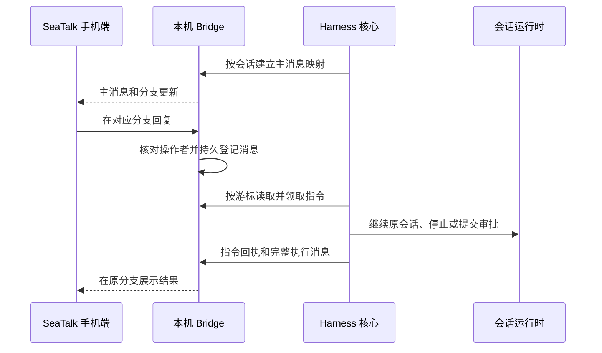

# SeaTalk 会话续聊

Harness 运行时默认将普通活动会话同步到一个 SeaTalk Bot。每个会话创建一条主消息，完整消息和执行事件发送到它的回复分支；在该分支回复文字会继续原会话，沿用上下文、模型和权限。远程操作使用明确的会话 ID，不切换电脑端选中的会话。

## 使用

电脑需保持唤醒，Harness 和本机 Bridge 需保持运行。Bridge 账号名固定为 `harness-sessions`，账号使用 SeaTalk OpenAPI 和 WebSocket 入站，`notificationTargetEmployeeCode` 指定唯一接收者和远程操作者。密钥由 Bridge 的受保护环境文件提供，账号配置保存环境变量引用。

所有普通活动会话自动建立映射，无需单独开启。启动时分页查询活动会话元数据；不会向 SeaTalk 回放整段历史。新输入、已完成的 Agent 消息、命令和工具完成事件、文件更新及轮次结果持续同步。流式文字在完整消息完成后发送，长消息按 UTF-8 字节拆分。

| 分支内输入 | 行为 |
| --- | --- |
| 普通文字 | 空闲时启动下一轮；执行中加入原会话队列 |
| `/状态` | 查询当前运行或等待状态 |
| `/停止` | 停止该分支对应会话的当前轮次 |
| `/批准 <请求编号>` | 批准对应的一次操作，不扩大到后续操作 |
| `/拒绝 <请求编号>` | 拒绝对应操作 |
| `/回答 <请求编号> 答案` | 回答单个问题 |
| `/回答 <请求编号> {"问题ID":"答案"}` | 回答多个问题，须包含全部题目 |

审批和提问通知携带请求编号，编号关联会话、请求 ID、方法和参数版本。已处理或已更新的请求会被拒绝。敏感问题只发送提醒，答案仍在 Harness 内填写。图片、文件和语音输入暂不支持。

## 运行与恢复



- Bot 只能由 Harness 执行会话操作；不能同时配置 Bridge 的独立 Codex runtime。Bridge 保存消息接收、分支映射、发送回执和指令领取记录，Harness 不另存聊天正文或 Bot 凭据。
- 本机接口固定为 `/local/harness/*`，只接受无 Origin 的 loopback 服务请求。每条指令同时校验 Bot 账号、原生分支以及 OpenAPI 回调中的员工编号，群聊、陌生人和未映射分支不能触发会话操作。
- 入站按递增游标分页追赶，跨实例在 Bridge SQLite 中原子领取。同一指令不会因为重复推送、重新轮询或重启再次执行。执行前恢复并核对当前轮次归属；其他存活 Harness 实例持有的轮次由对应实例处理，不自动接管。
- 每条出站消息使用稳定发送编号。Bridge 将原生 SeaTalk `message_id` 用作分支根 ID；本地消息记录 ID 不参与分支路由。
- 网络超时或进程退出可能发生在外部动作已生效之后。已领取指令、结果不明的发送不自动重放；界面和手机提示先核对状态。电脑休眠或 Bridge 与 SeaTalk 断开期间的平台历史补投取决于 SeaTalk，游标只能保证追赶 Bridge 已收到的消息。
- 核心同步不依赖插件页或会话选择；归档历史和临时辅助会话不自动回放。旧提问通知插件在会话通道在线时由核心抑制重复通知，离线时保留原有卡片作为兜底。

## 配套与验证

本功能需要 Bridge 的 `HarnessRemote` 配套路由，配套代码、测试和说明见 [Bridge 补丁](bridge-agent.patch)（基于 Bridge commit `a0eda98`）。部署前先在对应 Bridge checkout 执行 `git apply --check` 检查该补丁，再按 Bridge 自身流程纳入代码并重启服务；已有本地改动时先处理冲突，不覆盖其他功能。Bridge 账号必须已启用 Bot 私聊发送权限和用户消息事件，并在开放平台将接收方式设为 WebSocket。账号配置示例只包含引用：

```json
{
  "name": "harness-sessions",
  "platform": "seatalk_openapi",
  "config": {
    "appId": "env:BRIDGE_HARNESS_SESSIONS_APP_ID",
    "appSecret": "env:BRIDGE_HARNESS_SESSIONS_APP_SECRET",
    "notificationTargetEmployeeCode": "env:BRIDGE_CODEX_ALLOWED_EMPLOYEE_CODE",
    "inbound": { "type": "websocket" }
  }
}
```

实现入口为[核心同步服务](../../src/core/seatalk/service.ts)、[运行时挂载](../../src/core/seatalk/react.ts)与[原生 Bridge 客户端](../../src-tauri/src/local_connector.rs)。[同步服务测试](../../src/core/seatalk/service.test.ts)覆盖分支路由、分页、重复指令、过期问题、敏感问题、发送分段及失败回执；[会话测试](../../src/features/conversation/useHarness.asyncInput.test.ts)覆盖后台输入保持桌面选择、队列、权限上下文和原生错误传播。
